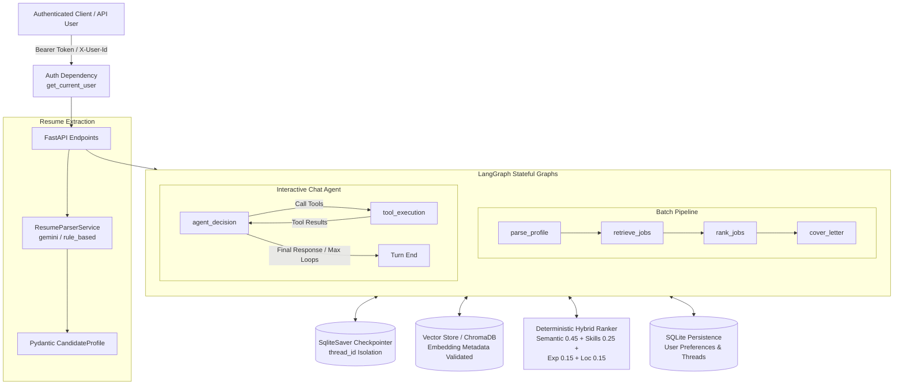

# AI Career Agent & Job Matching RAG Engine

A LLM-driven AI Career Agent built with **FastAPI**, **LangGraph**, **ChromaDB**, **SQLite**, and **Google Gemini**. Designed for semantic job retrieval, explainable 4-way hybrid ranking, candidate resume profiling, persistent thread-isolated memory, and real LLM tool-calling workflows.

---

## Architecture & Workflows



---

## Key Features

1. **Real Tool-Calling Agent**:
   - Built with supported Gemini SDK function calling and LangGraph stateful execution.
   - Callable tools: `search_jobs`, `get_job_details`, `save_job`, `update_preferences`, and `web_search_jobs`.
   - Automatic execution loop with configurable safety limit (`max_tool_calls`, default 5) preventing runaway loops.
   - Authenticated `user_id` context injected into tools so users cannot save jobs or modify preferences for other accounts.
2. **Persistent Conversational Memory & Checkpointing**:
   - Multi-turn state persistence powered by `langgraph.checkpoint.sqlite.SqliteSaver`.
   - Native `thread_id` passing through LangGraph's configurable invocation.
   - Enforced thread ownership: one authenticated user cannot access another user's threads or memory (returns HTTP 403 Forbidden).
   - User job search preferences automatically persist across multiple conversation threads.
3. **Explicit Backend Modes**:
   - `RESUME_PARSER_BACKEND`: `gemini` (strict Pydantic structured output) or `rule_based` (offline fallback). Never silently falls back when Gemini is configured.
   - `EMBEDDING_BACKEND`: `gemini` (`models/text-embedding-004`) or `mock` (deterministic 768-dim hash vectors for offline dev/tests).
   - `VECTOR_STORE_BACKEND`: `chroma` (ChromaDB persistent collection) or `memory` (exact cosine JSON vector store).
4. **Vector Store Metadata Validation**:
   - Stores `embedding_backend`, `embedding_model`, and `dimension` in Chroma collection metadata.
   - Proactively detects mismatched vector dimensions and halts with explicit instructions on how to rebuild/reindex the collection.
5. **Grounded 4-Way Hybrid Ranking**:
   - Rejects negative component weights and zero-total weights (`ValueError`).
   - Mathematically normalized scoring: Semantic Similarity (0.45) + Skill Overlap (0.25) + Experience Alignment (0.15) + Location Compatibility (0.15).
   - Handles edge cases neutrally when metadata is omitted, and appropriately penalizes location/work-mode mismatches (e.g. Remote applicant applying to on-site roles).
6. **Multi-Relevant Evaluation Benchmark**:
   - Multi-relevant benchmark dataset in `evaluation/test_queries.json` grounded against `data/sample_jobs.json`.
   - Independent metrics for Pure Semantic Retrieval and Hybrid Ranking: Recall@3, Precision@3, MRR, and NDCG@3.

---

## Setup & Execution

### 1. Environment Setup
```bash
cp .env.example .env
```
Configure your keys in `.env` (or run in offline mock mode without keys).

### 2. Install Dependencies
```bash
pip install -r requirements.txt
```

### 3. Run Automated Tests
```bash
pytest tests -v
```
All 30 automated tests pass with isolated temporary databases and fixtures. The live Gemini test is opt-in and automatically skipped when running offline.

### 4. Run Evaluation Benchmark
```bash
python -m evaluation.evaluate_retrieval
```

### 5. Launch FastAPI Backend
```bash
uvicorn app.main:app --host 0.0.0.0 --port 8000 --reload
```
Interactive Swagger API documentation: **[http://localhost:8000/docs](http://localhost:8000/docs)**

---

## Authentication & Authorization

All stateful and user-specific endpoints require cryptographically signed HMAC-SHA256 JWT tokens.

### 1. Generating a Token (`POST /auth/token`)
```json
// Request
{
  "user_id": "candidate_jane_doe",
  "email": "jane@example.com",
  "expires_in_minutes": 120
}

// Response
{
  "access_token": "eyJhbGciOiJIUzI1NiIsInR5cCI6IkpXVCJ9...",
  "token_type": "Bearer",
  "expires_at": "2026-11-20T03:30:00Z",
  "user_id": "candidate_jane_doe"
}
```

### 2. Using the Token in API Requests
Include the token in the standard HTTP header:
```http
Authorization: Bearer <access_token>
```
The server verifies signature, expiration (`exp`), and subject (`sub`). Client-provided body or query identities are never permitted to override the verified principal.

---

## API Reference

| Method | Endpoint | Description | Auth Required |
|---|---|---|---|
| `GET` | `/health` | Service health status check | No |
| `POST` | `/auth/token` | Issue signed JWT token for testing/dev | No |
| `POST` | `/resume/upload` | Upload PDF/DOCX/TXT and get structured candidate profile | No |
| `POST` | `/jobs/search` | Query the vector store semantically | No |
| `POST` | `/jobs/recommend` | 4-way hybrid ranking with transparent score breakdown and missing skills | No |
| `POST` | `/jobs/ingest` | Ingest and embed job postings with deterministic deduplication | Yes (Bearer JWT) |
| `POST` | `/jobs/{job_id}/save` | Save existing job to authenticated user profile | Yes (Bearer JWT) |
| `GET` | `/jobs/saved` | List saved jobs for authenticated user | Yes (Bearer JWT) |
| `POST` | `/agent/run` | Execute LangGraph batch Career Agent workflow | Yes (Bearer JWT) |
| `POST` | `/agent/chat` | Interactive multi-turn tool-calling conversational agent | Yes (Bearer JWT) |
| `GET` | `/agent/memory/{thread_id}` | Retrieve persistent memory and preferences for a thread | Yes (Bearer JWT) |
| `DELETE` | `/agent/memory/{thread_id}` | Clear isolated thread memory and delete LangGraph checkpoints | Yes (Bearer JWT) |

---

## Production Security & Deployment Notes

1. **Rate Limiting**:
   - For public-facing deployments, deploy behind an API Gateway or reverse proxy (e.g. Nginx, Cloudflare, Traefik) configured with token-bucket or sliding-window rate limiting (recommended: 60 req/min per IP on public endpoints, 120 req/min per user on authenticated endpoints).
2. **Database Concurrency**:
   - SQLite is utilized for zero-configuration local persistence and LangGraph checkpointing with WAL mode enabled. For large-scale distributed deployments with high write concurrency, transition `SqliteSaver` to `PostgresSaver`.
3. **External Search**:
   - Tavily live web search is an optional prototype fallback. The primary retrieval engine is the local vector store index.
